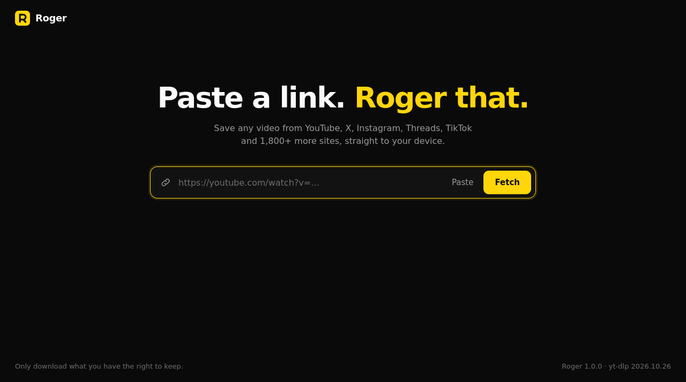

# Roger

Paste a link. Roger that.

Roger is a self-hosted web app for saving videos from YouTube, X, Instagram,
Threads, TikTok and 1,800+ other sites. Paste a link, pick a resolution or
audio-only mp3, and the file lands in your browser's downloads. No popups, no
fake download buttons, no sketchy redirects.



It is the web version of [yoinks](https://github.com/pablostanley/yoinks), a
terminal app. The server is a single Go binary with no dependencies outside the
standard library, and the interface is plain HTML, CSS and JavaScript embedded
in that binary. Downloading is done by [yt-dlp](https://github.com/yt-dlp/yt-dlp)
and ffmpeg.

## Deploy with Docker

```sh
cp docker-compose.example.yaml docker-compose.yaml
# edit docker-compose.yaml and set ROGER_PASSWORD
docker compose up -d --build
```

Open <http://localhost:8080> and sign in with any username and the password you
set. The image includes yt-dlp, ffmpeg and Deno.

Without Compose:

```sh
docker build -t roger .
docker run -d --name roger -p 8080:8080 -e ROGER_PASSWORD=change-me -v roger-data:/data roger
```

## Configuration

Everything is set with environment variables. An invalid value stops the server
at startup with a message naming the variable.

| Variable | Default | Description |
| --- | --- | --- |
| `ROGER_PASSWORD` | *empty* | Password for the interface, with HTTP Basic auth (any username). Empty disables it, and the server logs a warning. |
| `ROGER_PORT` | `8080` | Port to listen on inside the container. |
| `ROGER_MAX_CONCURRENT` | `2` | Downloads running at once. Others wait in a queue, up to 8 per slot in total. Beyond that, new downloads are refused. |
| `ROGER_FILE_TTL` | `15m` | How long a finished file stays on the server. Minimum `1m`. |
| `ROGER_DOWNLOAD_TIMEOUT` | `1h` | Longest a single download may run. Minimum `1m`. |
| `ROGER_MAX_FILESIZE` | *no limit* | Largest download, like `500M` or `2G`. Counts video and audio together. |
| `ROGER_YTDLP_UPDATE_INTERVAL` | `24h` in Docker, otherwise off | How often yt-dlp updates itself, starting at boot. `0s` turns it off. |
| `ROGER_YTDLP_ARGS` | *empty* | Extra yt-dlp options, split on spaces. See below. |
| `ROGER_ALLOW_PRIVATE_URLS` | `false` | Allow links to private and local addresses. See [Security](#security). |
| `ROGER_DATA_DIR` | `/data` in Docker, otherwise `$TMPDIR/roger` | Temporary files and the yt-dlp cache. Its `jobs` and `probes` folders are wiped at startup. |
| `ROGER_YTDLP_PATH` | `yt-dlp` | Path to the yt-dlp binary. |
| `ROGER_FFMPEG_PATH` | *from `PATH`* | Path to ffmpeg. |

Disk space: plan for `ROGER_MAX_CONCURRENT` downloads in progress, plus every
file finished in the last `ROGER_FILE_TTL`. A merge briefly needs about twice
the file's size.

### Sites that require a login

YouTube, Vimeo and others may refuse anonymous requests ("Sign in to confirm
you're not a bot"), especially from datacenter IP addresses. Export a
`cookies.txt` from a logged-in browser
([how](https://github.com/yt-dlp/yt-dlp/wiki/Extractors#exporting-youtube-cookies)),
mount it, and pass it to yt-dlp:

```yaml
environment:
  ROGER_YTDLP_ARGS: "--cookies /config/cookies.txt"
volumes:
  - ./cookies.txt:/config/cookies.txt
```

yt-dlp rewrites this file, so it must be writable by uid 1000. Cookies give
Roger access to that account, so prefer a throwaway one, and keep the instance
behind a password.

A proxy works the same way: `ROGER_YTDLP_ARGS: "--proxy socks5://host:1080"`.

### Behind a reverse proxy

Set `ROGER_PASSWORD` and terminate HTTPS at the proxy: Basic auth sends the
password with every request. Progress uses server-sent events and files can be
large, so the proxy must not buffer. Keep the original `Host` header too.

Caddy works without further settings:

```
roger.example.com {
    reverse_proxy roger:8080
}
```

nginx:

```nginx
location / {
    proxy_pass http://roger:8080;
    proxy_set_header Host $host;
    proxy_buffering off;
    proxy_read_timeout 1h;
}
```

## How it works

1. **Probe.** The server runs `yt-dlp -J` on the link and returns the title,
   thumbnail and format list.
2. **Download.** Your choice starts a job in a private temporary folder. The
   page follows its progress live.
3. **Hand-off.** When the job is done, the page starts a normal browser
   download. The server must finish first: merging video and audio into an mp4
   needs a complete file, so it can't be streamed as it arrives.
4. **Cleanup.** The file is deleted after `ROGER_FILE_TTL`. A cancelled download
   is removed at once, and so is one whose tab has been closed for a minute.

Nothing is kept for long: there is no database, jobs are lost on restart, and
your recent links stay in your browser's local storage. Roger doesn't log links.

Keyboard: `↵` to confirm, `esc` to go back or cancel, `↑`/`↓` or `j`/`k` or
number keys in the format list. Pasting a link fetches it right away.

## Security

Roger makes your server fetch whatever URL it's given, so treat it as a service
for people you trust.

- **Set a password** on anything reachable from the internet. Otherwise anyone
  can use your bandwidth and disk, and there is no rate limiting.
- **Internal addresses** are refused: links that resolve to private, loopback or
  link-local addresses never reach yt-dlp. This covers the link itself only. A
  public page can still redirect to an internal address, or change its DNS
  answer afterwards. If your network has sensitive unauthenticated services,
  also isolate the container from them with firewall rules or a dedicated Docker
  network, or send its traffic through an egress proxy with `--proxy`.
- **The container** runs as a non-root user, and the example Compose file drops
  all capabilities. The root filesystem has to stay writable for yt-dlp to update
  itself.
- **File links** contain a random 128-bit id, so finished files can't be guessed.
  With a password set, a file link also needs that password.

## Development

Requires Go 1.25+, yt-dlp and ffmpeg on your `PATH`, plus Deno for YouTube.
Tested on Linux.

```sh
go run .
go test -race ./...
```

The tests use a fake yt-dlp and need no network.

| File | Role |
| --- | --- |
| `main.go`, `config.go` | Startup, shutdown, environment variables |
| `server.go` | HTTP routes, auth, event stream, file delivery |
| `jobs.go` | Download queue, job state, cleanup |
| `ytdlp.go` | Running yt-dlp, format list, progress parsing |
| `urlcheck.go` | Link validation and platform names |
| `web/` | The interface, embedded at build time |

To change the yt-dlp version baked into the image:

```sh
docker build --build-arg YTDLP_VERSION=2026.10.26 -t roger .
```

## A note on fair use

Roger is a personal archiving tool. Downloading content may violate a platform's
terms of service. Only download what you have the right to keep, and be excellent
to creators.

## License

[MIT](LICENSE). Based on yoinks by Pablo Stanley.
